# MySQL 学习助手

**一个把 MySQL 从「会用」到「用好」做成可交互学习面板的 DSH 插件。**

[](LICENSE)
[](https://github.com/lniev/dsh-mysql-assistant/releases)
[](https://github.com/lniev/dsh-mysql-assistant)

> 知识地图 · 学习路线 · 企业级实战 · SQL 操练场 · AI 问答，五块内容互相打通的 MySQL 学习工作台。
> 83 个通俗知识点、24 道自动判题练习、8 个企业实战，内置电商示例库；默认离线可用，需要时还能切到真实 MySQL 8。

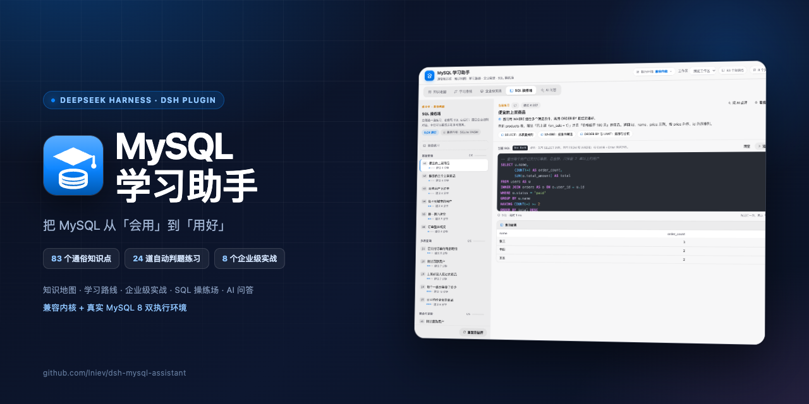

---

## 目录

- [为什么做这个](#为什么做这个)
- [功能总览](#功能总览)
- [快速开始](#快速开始)
- [五个模块怎么用](#五个模块怎么用)
  - [知识地图](#知识地图)
  - [学习路线](#学习路线)
  - [企业级实战](#企业级实战)
  - [SQL 操练场](#sql-操练场)
  - [AI 问答](#ai-问答)
- [执行环境：兼容内核 / 真实 MySQL](#执行环境兼容内核--真实-mysql)
- [Agent 工具](#agent-工具)
- [项目结构](#项目结构)
- [开发与测试](#开发与测试)
- [如何扩充内容](#如何扩充内容)
- [常见问题](#常见问题)
- [设计说明](#设计说明)
- [路线图](#路线图)
- [贡献与许可](#贡献与许可)
- [English summary](#english-summary)

---

## 为什么做这个

大多数 MySQL 学习资料的问题是：知识点是散的，练习环境要自己搭，报错没人讲，学完不知道离生产还差什么。这个插件把它们放进同一个面板里：

- **知识点有依赖关系**：83 个主题按「建立直觉 → SQL 能力 → 设计与优化 → 生产架构 → 企业实战」排成 5 层，点开每个节点都有通俗讲解、可运行 SQL、常见坑和企业建议；
- **学完马上能动手**：每道练习内置电商示例库，写 SQL → 运行 → 自动判题，不用装数据库；
- **知道自己在什么位置**：7 阶段、40 项任务的学习路线，每一项都有交付物和验收标准；
- **能对着真实环境验证**：一键从内置兼容内核切到本机 / Docker 的 MySQL 8，对照方言、执行计划与真实行为；
- **有问题可以直接问**：AI 问答接入真实 DSH 会话，能查内置知识库、看你的 SQL 和报错，还能以只读方式在操练场数据库里核对数据。

## 功能总览

| 模块 | 一句话 | 规模 |
| --- | --- | --- |
| **知识地图** | 点击式依赖地图 + 通俗讲解 + 可运行 SQL | 83 个知识点、5 层、182 条依赖、5 条推荐路线 |
| **学习路线** | 有交付物和验收标准的阶段任务 | 7 个阶段、40 项任务、3 条路线 |
| **企业级实战** | 从业务背景到可执行 SQL 的真实场景 | 8 个实战、每步含检查清单与踩坑提示 |
| **SQL 操练场** | 内置电商库 + 编辑器 + 自动判题 | 7 张表、24 道练习、3 种判题模式 |
| **AI 问答** | 基于内置知识库与操练场的真实会话 | 5 个快捷提问、上下文一键带入、只读排查工具 |

## 快速开始

### 环境要求

- 已安装 **DeepSeek Harness（DSH）**，使用带 Web UI / 插件机制的版本；
- **Node.js 20+**（插件 Host 依赖 `sql.js` / `mysql2`，测试也跑在 Node 上）；
- 可选：Docker 或本机 **MySQL 8**，只有「真实 MySQL」执行环境才需要。

### 安装

```bash
git clone https://github.com/lniev/dsh-mysql-assistant.git ~/ds-plugins/dsh-mysql-assistant
cd ~/ds-plugins/dsh-mysql-assistant
npm install
```

然后在 Harness 的插件管理器里把该目录作为 bundle 安装；或者让 Agent 执行：

```
plugin_manager install_bundle target=<该目录的绝对路径>
```

安装后刷新 Harness Web 页面，左侧栏会出现 **MySQL 学习助手** 入口。

> `client.js` 已随仓库提供；改过 `src/` 后执行 `node build.mjs` 重新生成即可。

### 让 AI 自动安装（推荐）

不想敲命令的话，把下面这段话直接发给 Harness 里的 Agent 即可：

> 帮我安装这个 DSH 插件：https://github.com/lniev/dsh-mysql-assistant
> 克隆到 `~/ds-plugins/dsh-mysql-assistant`，执行 `npm install`，然后用 `plugin_manager install_bundle` 安装该目录，确认插件已启用后告诉我刷新页面。

Agent 会自动完成：

1. `git clone` 仓库到插件目录（默认 `~/ds-plugins/dsh-mysql-assistant`）；
2. `npm install` 安装 `sql.js`、`mysql2` 等 Host 依赖；
3. 调用 `plugin_manager install_bundle`，把目录作为 bundle 安装到当前 profile；
4. 检查插件状态，提示你刷新 Harness Web 页面。

以后更新也可以直接说：

> 把 MySQL 学习助手更新到最新版本：拉取最新代码、重新 `npm install`、再重新安装一次 bundle。

> 前提：Agent 具备 shell 与插件管理权限，且机器可以访问 GitHub。安装完成后无需重启 Harness，刷新页面即可。

### 第一次打开建议这样用

1. 在 **知识地图** 点「MySQL 是什么」，先看一遍讲解和示例 SQL；
2. 在 **学习路线** 选「后端开发主线」，把第一阶段加入计划；
3. 在 **SQL 操练场** 从 `b1` 开始做基础查询，卡住时点「提示」；
4. 任何概念/报错看不懂，点「问 AI 讲解 / 问 AI 排查」直接带到 AI 问答。

## 五个模块怎么用

### 知识地图

83 个知识点按依赖排成五列：

- 节点点击后在右侧展开：**讲人话**、展开讲解、可运行 SQL、关键要点、常见坑、企业落地建议、相关知识；
- 悬停节点高亮它的依赖：实线箭头 = 当前节点依赖，淡虚线 = 相邻层关系；
- 相隔两层以上的长依赖不横穿中间列，而是从画布顶部的「跨层依赖」轨道绕行；
- 同列依赖画在卡片左侧的独立 gutter 里，不压卡片；
- 支持推荐路线高亮、搜索、标记已学、收起详情给地图让宽；
- 每段 SQL 都可以一键「在操练场运行」或「问 AI 讲解」。

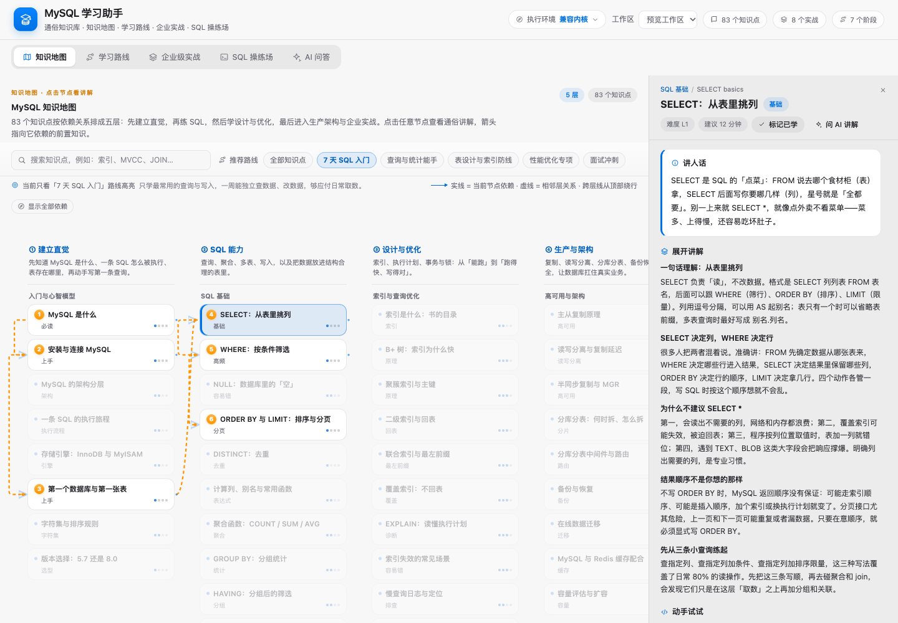

### 学习路线

- 3 条路线：**后端开发主线**、**有 SQL 基础速通**、**DBA / 运维方向**；
- 7 个阶段从「建立直觉与第一条查询」到「企业实战落地」；
- 每项任务包含：目标、要点、交付物、验收标准、怎么练（直接跳到地图/操练场）；
- 勾选记录进度，进度保存在本地。

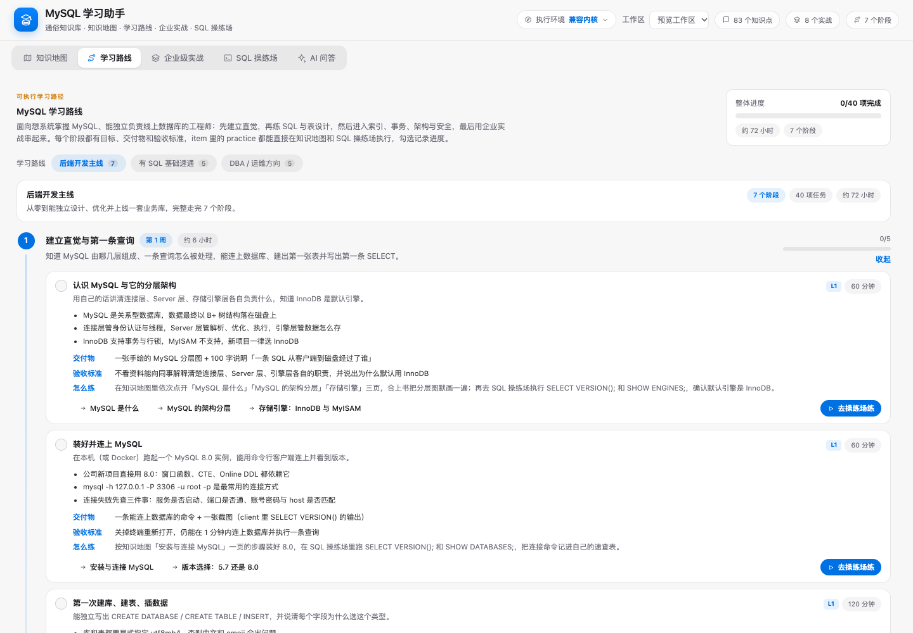

### 企业级实战

8 个从业务出发的场景：

1. 电商订单库建模
2. 订单查询与深分页优化
3. 慢查询定位与索引优化
4. 事务与库存防超卖
5. 订单幂等：唯一键与状态机
6. 报表统计与窗口函数
7. 主从复制与读写分离
8. 分库分表与在线迁移

每个实战包含业务背景、目标、步骤、可执行 SQL、上线检查清单、踩坑提示；SQL 可一键送进操练场运行。

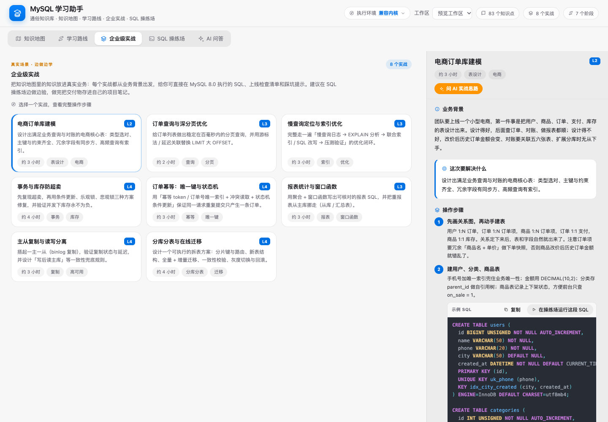

### SQL 操练场

- **内置电商示例库**：`users` / `categories` / `products` / `orders` / `order_items` / `payments` / `inventory` 共 7 张表、带种子数据；
- **24 道练习**，分为基础查询、多表查询、聚合与进阶、建表与写入、事务与优化；
- 编辑器支持 **Atom One Dark** 语法高亮（透明 textarea + 高亮层，无 CodeMirror/Monaco 依赖），支持 `Ctrl/⌘ + Enter` 运行；
- **自动判题**：`result`（结果集比较）、`verify`（再跑校验 SQL）、`schema`（表结构检查）；每次判题都在全新种子库上执行，不污染你的练习数据；
- 提供提示、参考答案、结果表格、执行耗时与错误提示；
- 报错或判题不通过时，可直接「问 AI 为什么错」；
- 数据可随时「重置数据库」恢复种子数据。

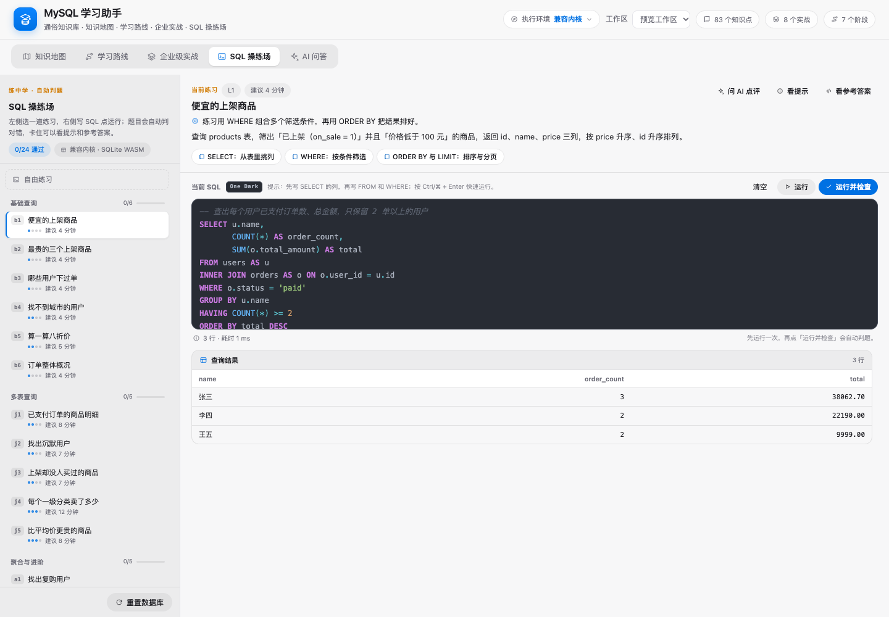

### AI 问答

第五个页签是一个**真实的 DSH 会话**，不是本地假回答：

- 首次打开在当前工作区创建「MySQL 问答」会话，**不写角色/人设/设定消息**，打开就是干净对话；
- 回答能力来自插件注册的系统提示：优先用 `mysql_docs` 检索内置知识库，通俗讲解、给电商示例、指出常见坑，并引用知识点 / 练习 id；
- 从地图「问 AI 讲解」、实战「问 AI 实战思路」、操练场「问 AI 点评 / 排查」进入时，只把当前主题、题目、SQL、最近一次结果或报错作为上下文发出去；
- 判题失败或 SQL 报错时，结果区直接出现「问 AI 为什么错」；
- AI 可以调用只读工具 `mysql_playground_query`，在当前执行环境里跑 `SELECT / SHOW / DESCRIBE / EXPLAIN / WITH` 核对数据；
- 会话是普通 DSH 会话：左侧栏可见历史，可「在对话中打开」或「新开一轮」。

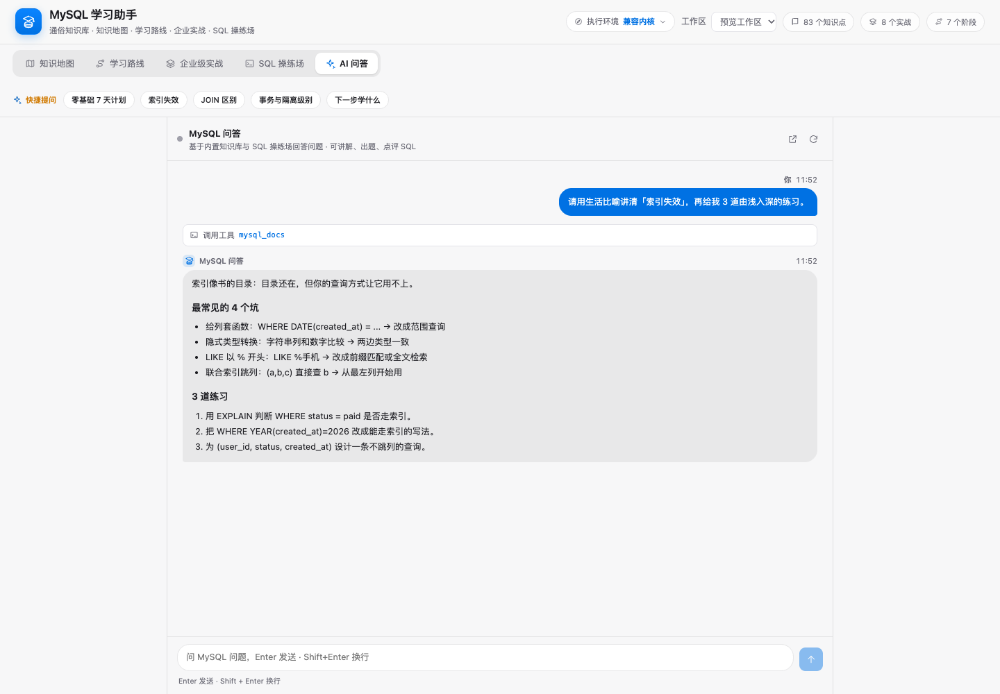

## 执行环境：兼容内核 / 真实 MySQL

页面右上角头部的「执行环境」可以随时切换，对所有页签可见。

### 兼容内核（默认）

- 内核：`sql.js`（SQLite 编译成 WebAssembly）；
- 无需安装数据库，离线可用；
- 运行在插件 Host 进程里，浏览器只发 HTTP 请求，SQL 不出本机；
- 内置 MySQL → SQLite 方言翻译：`AUTO_INCREMENT`、`ENGINE=InnoDB`、`SHOW TABLES/DATABASES/CREATE TABLE`、`DESCRIBE`、`LIMIT offset,count`、`IF()`/`CONCAT()`/`DATE_FORMAT()`/`NOW()`、`START TRANSACTION`、`TRUNCATE`、`INSERT IGNORE`、`ON DUPLICATE KEY UPDATE`、`EXPLAIN`、`ALTER TABLE ADD INDEX` 等；
- 与真实 MySQL 的差异：存储过程/触发器 `DELIMITER`、部分 `ALTER`、账号权限、复制/备份命令、`EXPLAIN` 输出格式、字符集/排序规则、真实锁与并发行为。这些内容在知识库中按真实 MySQL 讲解，操练场遇到不支持语句会给出提示。

### 真实 MySQL

适合想验证真实方言、执行计划、版本行为的学习者。

1. 启动一个专用学习库（推荐 Docker）：

   ```bash
   docker run --name mysql-learn \
     -e MYSQL_ROOT_PASSWORD=123456 \
     -e MYSQL_DATABASE=mysql_learn \
     -p 3306:3306 -d mysql:8
   ```

2. 点右上角「执行环境」→「真实 MySQL」，填写：
   - 主机：`127.0.0.1`
   - 端口：`3306`
   - 用户：`root`
   - 密码：`123456`
   - 数据库：`mysql_learn`
3. 先「测试连接」，再「连接并切换」。

行为说明：

- SQL 通过 `mysql2` 直接执行在你的 MySQL 8 上，schema 浏览器展示真实表结构；
- **判题**：结果类 / verify 类练习会在事务里执行并回滚；含 DDL 或显式 `BEGIN/COMMIT/ROLLBACK` 的练习请切回兼容内核；
- **重置**：真实模式下的「初始化 / 重建示例库」会删除该库所有表并重新建表灌数据，操作前会二次确认；请务必使用专用学习库，不要指向生产库；
- **连接信息**保存在插件目录 `.runtime/environment.json`（权限 `0600`，含密码，仅存本机，不会回传浏览器）；密码框留空表示沿用已保存密码；
- 连接失败会给出具体原因（拒绝连接、账号密码错误、数据库不存在、端口未映射等），并保持原执行环境不变。

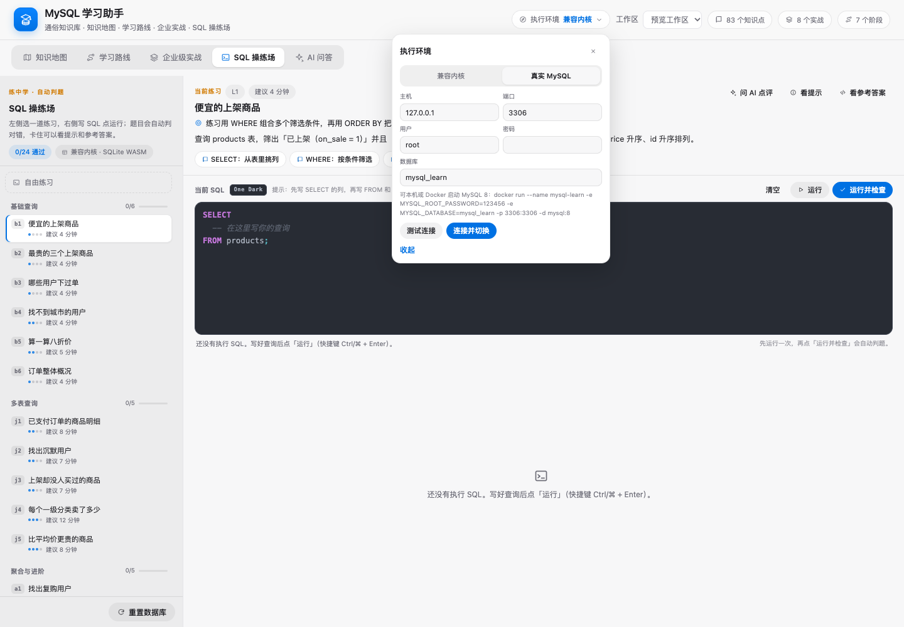

## Agent 工具

插件向 Agent 注册了两个工具与一段系统提示：

### `mysql_docs`

检索内置知识库，回答 MySQL 问题时优先于上网搜索：

| action | 作用 |
| --- | --- |
| `search` | 按关键词检索知识点（如 `索引失效`、`MVCC`、`分库分表`） |
| `read` | 读取某个知识点的完整讲解、SQL 示例、坑和企业建议 |
| `list` | 8 章目录 |
| `map` | 知识地图（层级、依赖、推荐路径） |
| `route` | 学习路线 |
| `labs` | 企业级实战 |
| `exercise` | 操练场练习清单 / 单题详情（含提示与参考答案） |

### `mysql_playground_query`

在 SQL 操练场当前执行环境上执行**只读** SQL（`SELECT / SHOW / DESCRIBE / EXPLAIN / WITH`），用于复现用户的查询、核对数据、辅助排查；写操作和 DDL 会被拒绝。

## 项目结构

```text
index.js                       Host 半：知识 API、mysql_docs 工具、操练场 API
host/sql-runtime.js            兼容内核（sql.js/SQLite）+ 方言翻译 + 自动判题
host/mysql-runtime.js          真实 MySQL 执行环境（mysql2、结构浏览、事务判题、示例库重建）
client.js                      构建产物（勿手改）
src/                           浏览器半源码（面板 + 五个视图 + AI 会话链路）
  views/                       知识地图 / 学习路线 / 企业实战 / 操练场 / AI 问答
  styles/                      各视图样式
  panel.js                     面板壳：页头、执行环境、页签、跨页跳转
knowledge/manifest.json        83 个知识点 id 清单（章节、难度、层级）
knowledge/pages/**/*.json      每个知识点一个 JSON（讲解、SQL、坑、企业建议）
knowledge/map.json             知识地图（依赖关系、推荐路线）
knowledge/learning-route.json  学习路线
knowledge/labs.json            企业级实战
knowledge/data.json            构建产物：合并后的内容包
playground/shop-schema.sql     电商示例库 DDL + 种子数据
playground/exercises.json      24 道练习与判题配置
scripts/                       构建、内容校验、测试与截图脚本
docs/screenshots/              文档截图
```

## 开发与测试

```bash
npm install                    # 安装 sql.js、mysql2 与测试依赖
npm run validate               # 内容 schema / 引用完整性校验
npm run build:data             # knowledge/ → knowledge/data.json
npm run build                  # src/ → client.js
npm test                       # 全量：校验 + 构建 + smoke + Host API + SQL + MySQL + UI
```

也可以单独运行：

```bash
npm run test:host              # Host API 与工具
npm run test:sql               # 兼容内核与判题
npm run test:ui                # jsdom 渲染与交互
```

测试覆盖：

- 83 个知识点、地图 83 节点、182 条依赖、无环、推荐路径完整；
- 7 阶段 40 项路线、8 个实战、24 道练习的参考答案全部可判题通过；
- Host API、`mysql_docs`、`mysql_playground_query`（含只读校验）；
- 真实 MySQL 运行时的连接、结构、判题、重建示例库逻辑（用注入的 fake 连接测试，不强依赖 CI 里有 MySQL）；
- jsdom 下五个页签的渲染、点击、判题、执行环境弹层与跨页跳转。

文档截图由维护者在本地生成：先运行 `node scripts/preview-map.mjs --tab "SQL 操练场"` 得到预览 HTML（`/tmp/mysql-map-preview.html`），再用无头 Chrome 截取对应区域，产物保存在 `docs/screenshots/`。

仓库封面 / 社交预览图是 `docs/cover.png`（1280×640，小于 1MB）。GitHub 不支持用 API 设置社交预览，需要到仓库 **Settings → Social preview** 手动上传这张图。

## 如何扩充内容

### 新增一个知识点

1. 在 `knowledge/pages/<chapter>/<id>.json` 新建页面；
2. 在 `knowledge/manifest.json` 登记 id、章节、难度、层级；
3. 在 `knowledge/map.json` 的 `nodes` 中加入节点，并在 `deps` 里声明它依赖的知识点；
4. `npm run build:data && npm run validate`。

### 新增一道练习

1. 在 `playground/exercises.json` 里按现有结构添加题目（含 `check` 配置）；
2. 确保参考答案在兼容内核下能通过：`npm run test:sql`；
3. `npm test` 确认判题、UI 和内容校验都通过。

## 常见问题

**左侧栏没有入口？**
确认 bundle 安装成功、插件处于启用状态，然后刷新 Harness Web 页面。

**操练场打不开 / 白屏？**
先执行 `npm install`，再 `npm run build:data && npm run build`；检查控制台 Host 日志是否有 `sql.js` wasm 加载错误。

**真实 MySQL 连不上？**
按提示排查：服务是否启动、端口是否映射（Docker `-p 3306:3306`）、账号密码、数据库是否存在、防火墙/权限。测试连接通过后再切换。

**能在真实 MySQL 上判题吗？**
结果类 / verify 类可以（事务执行后回滚）；DDL 和显式事务类练习会提示切回兼容内核。

**点「初始化 / 重建示例库」安全吗？**
真实 MySQL 模式下会删除所选数据库的所有表。请使用专用学习库，不要指向生产库；兼容内核模式只影响内存中的示例库。

**密码存在哪里？**
仅存在插件目录 `.runtime/environment.json`，文件权限 `0600`，不会回传浏览器，也不会写进日志。

**为什么操练场和真实 MySQL 的结果有时不同？**
兼容内核是 SQLite + 方言翻译，不是真正的 mysqld。执行计划、锁、字符集、函数细节以真实 MySQL 为准；这也正是「执行环境切换」的价值。

**AI 问答为什么没有角色设定？**
回答能力来自插件注册的系统提示，而不是聊天里的可见人设；这样对话保持干净，同时 AI 仍然会优先查内置知识库。

## 设计说明

- **Apple 设计语言**：系统蓝 `#0071E3` 为主色、系统橙 `#FF9500` 少量点缀，SF 字体、毛玻璃页头、分段式页签、胶囊按钮与柔和阴影；浅色/深色主题均可读；
- **One Dark 代码面**：SQL 高亮使用 Atom One Dark 配色，与页面外壳形成 IDE 式对比；
- **无重量级依赖**：编辑器用「透明 textarea + 高亮层」，不引入 CodeMirror/Monaco；知识库与练习全部本地 JSON，构建期生成；
- **可回归**：内容、Host、兼容内核、真实 MySQL 逻辑、UI 都有对应测试。

## 路线图

- [x] 知识地图 / 学习路线 / 企业实战 / SQL 操练场 / AI 问答
- [x] 兼容内核 + 真实 MySQL 双执行环境
- [x] 自动判题、结果对比、错误提示
- [x] Atom One Dark 语法高亮
- [ ] 更多练习与实战场景
- [ ] 学习进度导出 / 导入
- [ ] SQL 执行计划可视化对比（兼容内核 vs 真实 MySQL）
- [ ] 英文版界面

## 贡献与许可

欢迎提 Issue / PR：新增知识点、练习、实战、翻译、UI 优化都可以。

- 内容格式见 `scripts/validate-content.mjs`；
- 提交前请跑 `npm test`；
- License: [MIT](LICENSE) © 2026 lniev。

## English summary

**MySQL Learning Assistant** is a DeepSeek Harness (DSH) plugin that turns MySQL learning into one interactive workspace:

- an interactive **knowledge map** of 83 plain-language topics with dependency-aware edges;
- a staged **learning route** (7 stages / 40 tasks / 3 tracks);
- **8 enterprise labs** with executable SQL and checklists;
- a seeded **SQL playground** (7 tables, 24 auto-graded exercises, Atom One Dark highlighting);
- an **execution environment switch** between the bundled SQLite-compatible kernel and a real local/Docker MySQL 8;
- an **AI Q&A** tab grounded in the built-in knowledge base, with a read-only `mysql_playground_query` tool for debugging.

Core content works offline; real MySQL mode and AI Q&A need the respective services.

## 更多截图

| | |
| --- | --- |
| 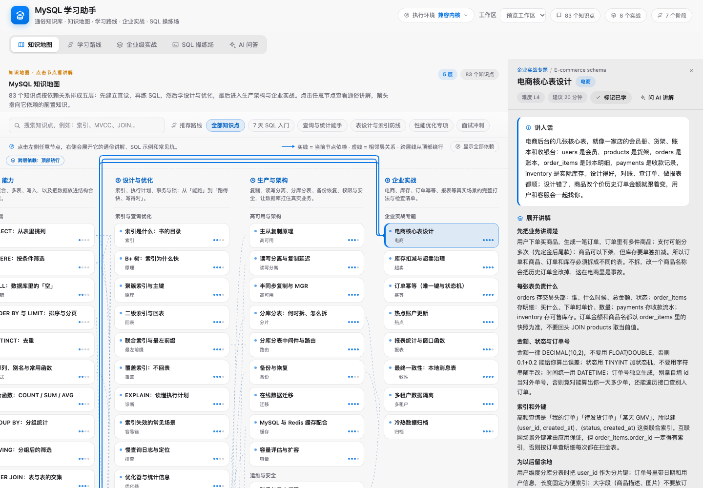 | 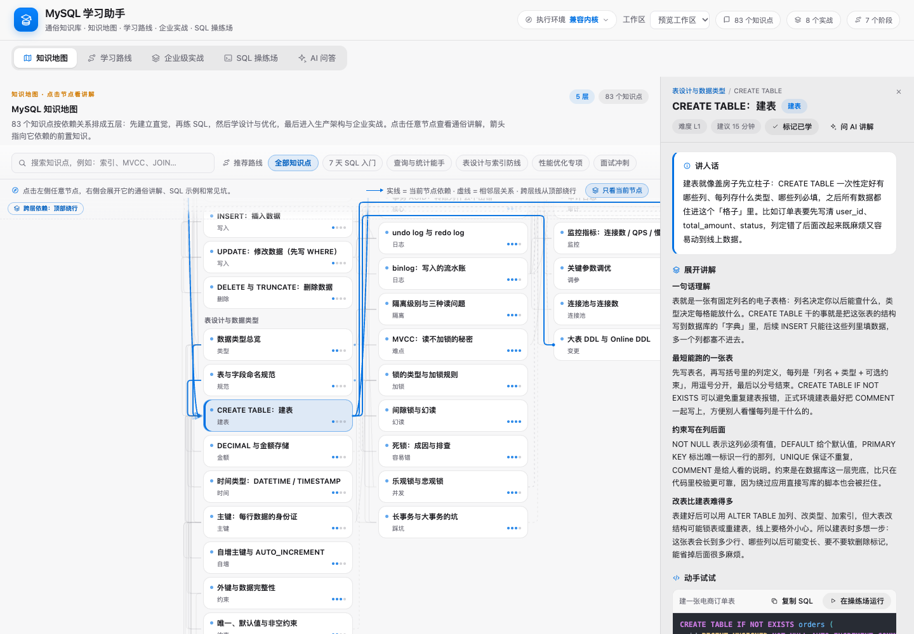 |
| 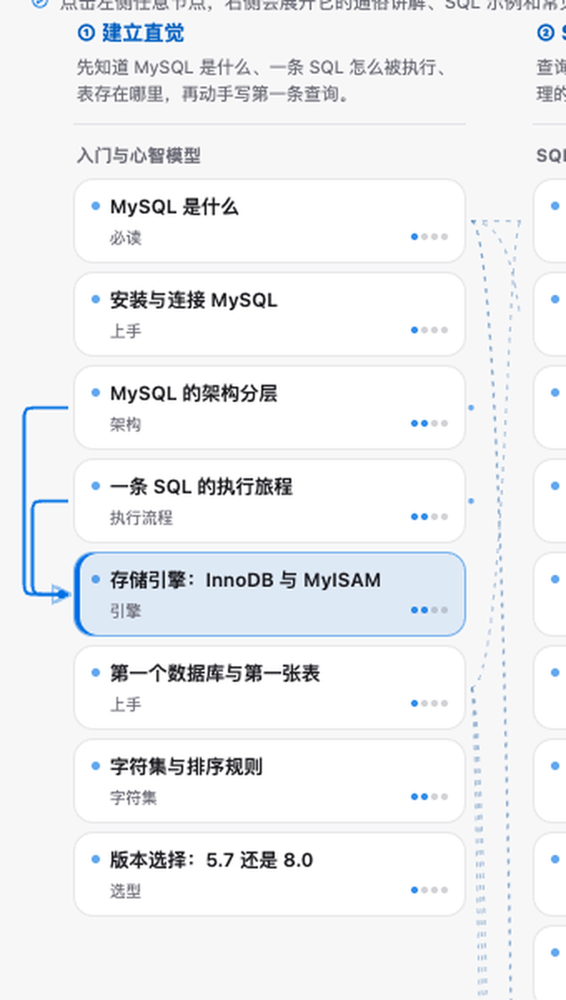 | 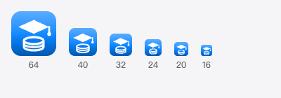 |
