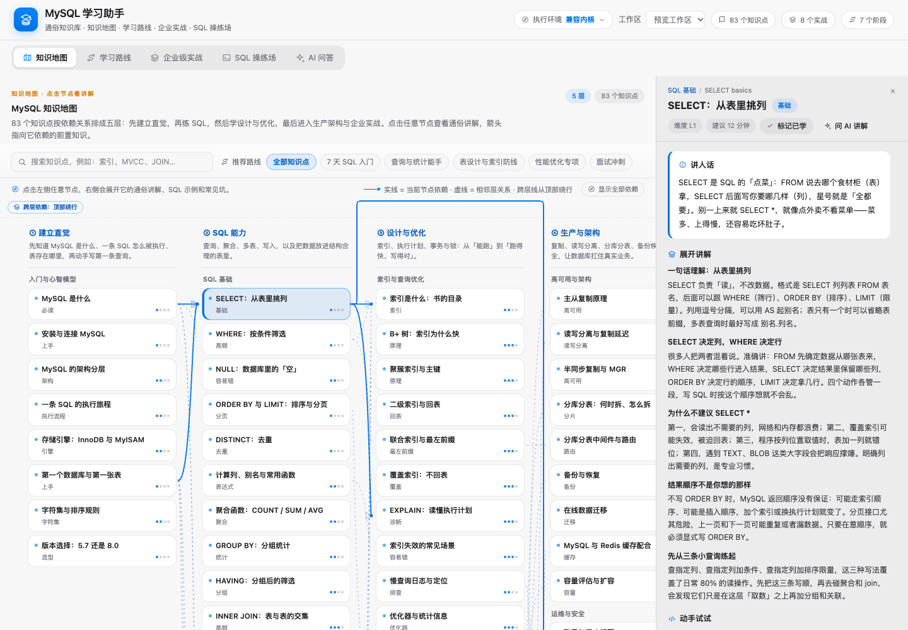

# MySQL 学习助手（@local/mysql-assistant）

把 MySQL 从「会用」到「用好」做成一个可交互的学习面板：知识地图、学习路线、企业级实战和 SQL 操练场全部内置，离线可用，讲人话、给例子、能动手。

在 Harness Web UI 左侧栏点 **MySQL 学习助手** 打开。

## 四个标签页

| 标签页 | 内容 |
| --- | --- |
| **知识地图** | 83 个知识点按依赖关系排成 5 层（建立直觉 → SQL 能力 → 设计与优化 → 生产架构 → 企业实战）。节点可点击，右侧展开通俗讲解、可运行 SQL、关键要点、常见坑、企业落地建议与相关知识；悬停节点高亮它的依赖关系；实线带箭头表示当前节点的依赖，淡虚线表示相邻层关系，可切换「显示全部依赖」；**相隔两层以上的长依赖不再横穿中间列**，而是从画布顶部的「跨层依赖」通道绕行（滚动时始终停留在可视区顶部），不会被中间列遮挡；选中的推荐路线会用金色虚线串起来；详情栏可以收起，给地图让出宽度。 |
| **学习路线** | 7 个阶段、40 项任务、3 条路线（后端主线 / 有 SQL 基础速通 / 运维方向）。每项含目标、要点、交付物、验收标准与练习动作，支持勾选记录进度。 |
| **企业级实战** | 8 个真实场景：电商订单库建模、查询与深分页、索引优化、事务与库存防超卖、订单幂等、报表统计、主从读写分离、分库分表与在线迁移。每步给可执行 SQL、上线检查清单和踩坑提示，SQL 可一键送进操练场。 |
| **SQL 操练场** | 左侧练习目录 + 示例库结构，右侧**带语法高亮的 SQL 编辑器** + 结果表格 + 自动判题。内置电商示例库（7 张表、种子数据），24 道练习（基础 / 多表 / 聚合 / 写入 / 事务），SQL 高亮使用 Atom One Dark 配色（暗色代码面）；支持 `result` / `verify` / `schema` 三种判题方式、提示、参考答案与数据库重置；**执行环境可切换**：默认兼容内核，也可连接真实本机/Docker 的 MySQL 8。 |
| **AI 问答** | 真实的 DSH 会话：按当前主题/实战/练习一键带入上下文提问，也可以直接输入问题；顶部有 5 个快捷提问（入门计划、索引失效、JOIN 区别、事务隔离级别、下一步学什么）。回答会先查内置知识库（`mysql_docs`），可讲解、出题、点评 SQL、做学习规划；会话保存在当前工作区，可「在对话中打开」或「新开一轮」。不写入任何角色/人设设定，只传必要的问题上下文。 |

## AI 问答

第五个页签是一个真实的 DSH 会话，不是本地假回答：

- 首次打开会在当前工作区创建一个「MySQL 问答」会话，**不写任何角色／人设／设定消息**，打开即是一段干净的空对话；
- 回答能力来自插件注册的系统提示（而不是聊天里的可见设定）：优先用 `mysql_docs` 工具检索内置知识库，通俗讲解、给电商示例、指出常见坑，并在合适时引用知识点 id 和练习 id；
- 从知识地图「问 AI 讲解」、企业实战「问 AI 实战思路」、操练场「问 AI 点评 / 排查」进入时，只把当前主题 id / 实战目标 / 题目、你编辑器里的 SQL 以及最近一次执行结果或报错作为问题上下文发出去；
- 操练场里运行报错或判题不通过时，结果区会直接出现「问 AI 为什么错」；AI 还可以调用只读工具 `mysql_playground_query` 在当前执行环境里跑 `SELECT/SHOW/DESCRIBE/EXPLAIN/WITH` 核对数据，帮你定位是 SQL 写法、数据还是环境差异的问题；
- 会话是普通 DSH 会话：左侧栏可见历史，点右上角「在对话中打开」到主对话继续，或「新开一轮」重新开始。

## Agent 工具

插件注册了 `mysql_docs` 工具与一段系统提示，Agent 回答 MySQL 问题时可直接检索内置知识库，不必上网：

- `action: "search"` / `"read"` / `"list"` —— 检索、读取知识点、目录；
- `action: "map"` / `"route"` / `"labs"` —— 知识地图、学习路线、企业实战；
- `action: "exercise"` —— 操练场练习清单或单题详情（含提示与参考答案）。

## 安装

```bash
# 在本 profile 中安装（目录即插件包）
plugin_manager install_bundle target=/Users/lniev/ds-plugins/mysql-assistant
```

安装后刷新 Harness Web 页面，左侧栏出现入口。

## 开发

```bash
npm install          # 安装 sql.js 与测试用 devDependencies
node scripts/build-data.mjs   # 合并 knowledge/ 内容 → knowledge/data.json
node build.mjs                # 拼接 src/ → client.js
npm test                      # 内容校验 + 构建 + smoke + Host API + SQL 运行时 + jsdom UI 测试
```

目录：

```
index.js                 Host 半：知识 API、mysql_docs 工具、操练场 API
host/sql-runtime.js      MySQL 兼容内核（sql.js/SQLite）+ 方言翻译 + 自动判题
host/mysql-runtime.js    可选的「真实 MySQL」执行环境（mysql2 连接、结构浏览、事务判题、示例库重建）
client.js                构建产物（勿手改）
src/                     浏览器半源码（面板 + 五个视图 + AI 会话链路，构建时拼接）
knowledge/manifest.json  83 个知识点的唯一 id 清单（章节、难度、层级）
knowledge/pages/**       每个知识点一个 JSON（通俗讲解、SQL 样例、坑、企业建议）
knowledge/map.json       知识地图（依赖关系、推荐路线）
knowledge/learning-route.json  学习路线
knowledge/labs.json      企业级实战
playground/shop-schema.sql     电商示例库 DDL + 种子数据
playground/exercises.json      24 道练习与判题配置
scripts/                 构建、内容校验与测试脚本
```

## SQL 语法高亮

编辑器采用「透明 textarea + 独立高亮层」实现：textarea 负责输入、光标、选区和撤销，后面一层渲染 token 颜色并跟随滚动，因此没有引入 CodeMirror/Monaco 之类的重量级依赖。高亮覆盖关键字、数据类型、函数、字符串、数字、注释、反引号标识符；知识地图/企业实战里的 SQL 代码块与「参考答案」共用同一个 tokenizer。

## SQL 执行环境（当前实现）

**不是真实 MySQL 服务**，而是插件 Host 进程内的 MySQL 兼容内核：

- 内核：`sql.js`（把 SQLite 编译成 WebAssembly），随插件依赖安装，不需要额外安装或启动数据库；
- 位置：运行在插件 Host 进程里（Electron 主进程），浏览器只发 HTTP 请求，SQL 不出本机；
- 数据：启动时用 `playground/shop-schema.sql` 建表 + 灌种子数据，数据库在内存中；编辑器的会话库会一直保留修改，点「重置数据库」恢复种子数据；**判题**每次在全新的种子库上分别执行你的 SQL 与参考答案再比较，互不污染；
- 方言：兼容层把常用 MySQL 8.0 写法翻译到 SQLite，包括 `AUTO_INCREMENT`、`ENGINE=InnoDB DEFAULT CHARSET`、`SHOW TABLES/DATABASES/CREATE TABLE/INDEX`、`DESCRIBE`、`LIMIT offset,count`、`IF()`/`CONCAT()`/`DATE_FORMAT()`/`NOW()`、`START TRANSACTION`、`TRUNCATE`、`INSERT IGNORE`、`ON DUPLICATE KEY UPDATE`、`EXPLAIN`（转成更易读的 `EXPLAIN QUERY PLAN`）、`ALTER TABLE ADD INDEX` 等；
- 差异：存储过程 / 触发器里的 `DELIMITER`、部分 `ALTER`（如给已有表加主键）、账号权限（`CREATE USER`/`GRANT`）、复制/备份类命令、`EXPLAIN` 输出格式、字符集与排序规则、真实的行锁/MVCC 并发行为与 sysbench 级性能表现。这些内容在知识库里按真实 MySQL 讲解；操练场里对不支持的语句会给出「已跳过/需在 MySQL 客户端执行」的提示，并在侧栏常驻内核说明。

## 执行环境切换（兼容内核 / 真实 MySQL）

页面右上角头部的「执行环境」可以随时切换（对所有页签可见）：

- **兼容内核（默认）**：sql.js/SQLite WASM，无需安装任何数据库，数据在内存里、重置即恢复；判题在全新种子库上执行；
- **真实 MySQL**：填主机、端口、用户、密码、数据库后「测试连接 / 连接并切换」，之后的 SQL 会通过 `mysql2` 直接执行在你的 MySQL 8 上，schema 浏览器展示真实库结构。

使用说明：

- 推荐用专用学习库，例如先在本机或 Docker 启动一个 MySQL 8：

  ```bash
  docker run --name mysql-learn \
    -e MYSQL_ROOT_PASSWORD=123456 \
    -e MYSQL_DATABASE=mysql_learn \
    -p 3306:3306 -d mysql:8
  ```

  然后在执行环境里填 `127.0.0.1` / `3306` / `root` / `123456` / `mysql_learn` 连接即可。
- 连接信息保存在插件目录的 `.runtime/environment.json`（权限 0600，含密码，仅存本机，不会回传浏览器）；不想保存密码可以在表单里留空「已保存，留空不修改」。
- **判题**：结果类/verify 类练习会在事务里执行并回滚；包含 DDL（建表）或显式 `BEGIN/COMMIT/ROLLBACK` 的练习请在兼容内核里判题。
- **重置**：真实 MySQL 模式下点「初始化 / 重建示例库」会**删除该库所有表**并重新建表灌数据，操作前会二次确认；请务必使用专用学习库，不要指向生产库。
- 真实 MySQL 的权限、版本行为、字符集/排序规则、锁与执行计划都以你自己的服务器为准，这正是和兼容内核对照学习的地方。

如果连接失败，界面会给出具体原因（拒绝连接、账号密码错误、数据库不存在、端口未映射等），并保持在兼容内核上，不会丢失当前练习。

## 截图

`docs/screenshots/` 下有四个标签页的截图（由 `scripts/preview-map.mjs` + headless Chrome 生成）。界面采用 Apple 设计语言：系统蓝 #0071E3 作为主色、系统橙 #FF9500 少量点缀，SF 字体、毛玻璃页头、分段式页签、胶囊按钮与柔和阴影；浅色/深色主题下都保持可读：




## 验证

`npm test` 覆盖：内容 schema 与引用完整性、知识地图 83 节点覆盖与无环、24 道练习参考答案全部判题通过、Host API 与 `mysql_docs` 工具、以及 jsdom 下四个标签页的真实渲染与点击交互。
